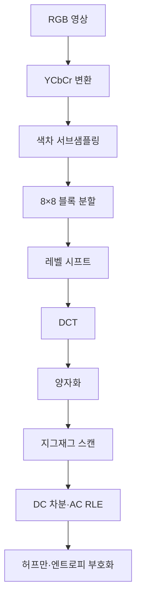

# 📝 [Week 13] 영상 압축의 기초 (Fundamentals of Image Compression)

## 1. 학습 개요

영상 압축(Image Compression)은 사람이 보거나 시스템이 처리하는 데 필요한 정보를 가능한 한 유지하면서, 영상을 저장하거나 전송하는 데 필요한 비트 수를 줄이는 기술입니다.

압축은 단순히 데이터를 삭제하는 작업이 아닙니다. 영상에 반복해서 나타나는 정보와 사람이 민감하게 느끼지 못하는 정보를 찾아 제거하고, 중요한 성분에 더 많은 비트를 배분하는 과정입니다.

이번 주차에서는 다음 흐름으로 영상 압축의 원리를 학습합니다.

> **영상의 중복성 → 정보량과 엔트로피 → 무손실 부호화 → 변환 부호화 → JPEG 파이프라인 → 압축 품질 평가**

### 핵심 키워드

| 개념 | 역할 |
| --- | --- |
| **Redundancy** | 원본 표현에 포함된 불필요하거나 반복되는 정보 |
| **Entropy** | 확률분포가 갖는 평균 정보량이자 무손실 압축의 이론적 하한 |
| **RLE** | 반복되는 값을 값과 반복 횟수로 표현하는 무손실 부호화 |
| **Huffman Coding** | 자주 발생하는 기호에 짧은 코드를 배정하는 가변 길이 부호화 |
| **DCT** | 공간 영역의 화소를 주파수 계수로 변환하여 에너지를 저주파에 집중 |
| **Quantization** | DCT 계수를 제한된 정밀도로 표현하는 JPEG의 핵심 손실 단계 |
| **Differential Encoding** | 인접한 값 자체가 아닌 값의 차이를 부호화 |
| **JPEG** | 색 변환, DCT, 양자화, RLE, 엔트로피 부호화를 결합한 손실 압축 표준 |

---

## 2. 영상 압축이 가능한 이유

영상 데이터에는 다음 네 종류의 중복성이 존재합니다.

| 중복성 | 의미 | 대표적인 제거 방법 |
| --- | --- | --- |
| **부호화 중복성** | 자주 등장하는 기호에도 긴 코드를 사용하는 비효율 | 허프만·산술 부호화 |
| **공간적 중복성** | 한 영상에서 이웃 화소의 값이 서로 비슷함 | 예측 부호화, DCT, RLE |
| **시간적 중복성** | 동영상의 연속 프레임이 서로 비슷함 | 프레임 간 예측, 움직임 보상 |
| **지각적 중복성** | 인간이 민감하게 느끼지 못하는 정보가 포함됨 | 양자화, 색차 서브샘플링 |

영상 압축 알고리즘은 이 중복성을 줄이는 방향으로 설계됩니다.

---

## 3. 정보 이론과 무손실 압축

### 3.1 자기 정보량

확률이 낮은 사건일수록 발생했을 때 더 많은 정보를 제공합니다. 발생 확률이 $p_i$인 사건 $x_i$의 자기 정보량은 다음과 같습니다.

$$
I(x_i)=-\log_2 p_i
$$

- 자주 발생하는 사건: 정보량이 작음
- 드물게 발생하는 사건: 정보량이 큼
- 밑이 2인 로그를 사용하므로 단위는 bit

### 3.2 엔트로피

확률변수의 평균 정보량인 엔트로피는 다음과 같습니다.

$$
H=-\sum_{i=1}^{n}p_i\log_2 p_i
$$

엔트로피는 주어진 확률분포를 손실 없이 부호화할 때 필요한 평균 비트 수의 이론적 하한을 제시합니다.

예를 들어 6개 기호의 확률이 다음과 같다고 가정합니다.

$$
0.25,\ 0.25,\ 0.125,\ 0.125,\ 0.125,\ 0.125
$$

6개 기호를 고정 길이 코드로 표현하려면 기호당 3비트가 필요하지만 엔트로피는 2.5비트입니다. 기호의 발생 확률이 균일하지 않으므로 자주 등장하는 기호에 더 짧은 코드를 배정할 수 있습니다.

### 3.3 평균 코드 길이

기호 $x_i$의 발생 확률을 $p_i$, 코드 길이를 $l_i$라고 하면 평균 코드 길이는 다음과 같습니다.

$$
L=\sum_{i=1}^{n}p_i l_i
$$

좋은 무손실 부호는 평균 코드 길이 $L$을 엔트로피 $H$에 가깝게 만듭니다. 기호별 이진 허프만 부호의 평균 코드 길이는 다음 범위를 만족합니다.

$$
H\leq L < H+1
$$

### 3.4 압축률

압축률(Compression Ratio)은 원본 크기와 압축 결과 크기의 비율입니다.

$$
CR=\frac{\text{원본 데이터 크기}}{\text{압축 데이터 크기}}
$$

- $CR>1$: 데이터 크기가 감소함
- $CR=1$: 크기 변화가 없음
- $CR<1$: 부가 정보 때문에 오히려 크기가 증가함

압축 후 크기가 원본의 몇 퍼센트인지 나타내는 압축 비율이나, 단위 시간·화소당 비트 수를 나타내는 비트율과 혼동하지 않도록 정의를 확인해야 합니다.

### 3.5 압축 방식의 분류

| 기준 | 구분 | 특징 | 대표 사용 예 |
| --- | --- | --- | --- |
| 복원 정확성 | **무손실 압축** | 원본과 완전히 동일하게 복원 | 문서, 의료 원본, 마스크, 소스 데이터 |
| 복원 정확성 | **손실 압축** | 덜 중요한 정보를 제거해 높은 압축률 확보 | 자연영상, 사진, 영상 스트리밍 |
| 중복 위치 | **공간적 압축** | 한 영상 내부의 이웃 화소 중복 제거 | JPEG, PNG 예측 필터 |
| 중복 위치 | **시간적 압축** | 연속 프레임 사이의 변화만 부호화 | MPEG, H.264/AVC, HEVC |

자연영상과 동영상은 작은 왜곡을 허용해 높은 압축률을 얻는 경우가 많지만, 의료 진단 영상이나 정답 마스크는 정보 손실의 영향이 크므로 목적에 맞는 방식을 선택해야 합니다.

---

## 4. 대표적인 무손실 부호화

### 4.1 런 길이 부호화 (Run-Length Encoding, RLE)

RLE는 연속으로 반복되는 값을 **값과 반복 횟수**의 쌍으로 저장합니다.

```text
원본: AAAABBBBBCCCCCCCCDEEEE
부호: 4A5B8C1D4E
```

각 문자와 한 자리 반복 횟수를 각각 1바이트로 저장한다고 가정하면, 예시에서는 원본 22바이트가 10바이트로 줄어 압축률은 다음과 같습니다.

$$
CR=\frac{22}{10}=2.2
$$

RLE는 다음 데이터에서 효과적입니다.

- 단색 영역이 넓은 이진 영상
- 문서 영상과 팩스
- 단순한 아이콘과 그래픽
- JPEG 지그재그 스캔 이후의 연속된 0

반대로 자연영상처럼 값이 자주 바뀌면 반복 횟수 정보가 추가되어 압축 효율이 낮아지거나 데이터가 커질 수 있습니다.

### 4.2 허프만 부호화 (Huffman Coding)

허프만 부호화는 발생 확률이 높은 기호에는 짧은 코드를, 확률이 낮은 기호에는 긴 코드를 배정하는 가변 길이 무손실 부호입니다.

#### 허프만 트리 생성 과정

1. 모든 기호를 발생 확률의 오름차순으로 정렬합니다.
2. 확률이 가장 작은 두 노드를 선택해 하나로 합칩니다.
3. 합친 노드를 다시 목록에 넣습니다.
4. 하나의 루트 노드만 남을 때까지 반복합니다.
5. 각 가지에 0과 1을 배정해 코드워드를 얻습니다.

허프만 코드는 **접두 부호(Prefix Code)**입니다. 어떤 코드도 다른 코드의 시작 부분이 되지 않으므로 구분 기호 없이 비트열을 순차적으로 복호화할 수 있습니다.

확률이 $0.5$, $0.25$, $0.125$, $0.125$인 네 기호에 코드 길이 $1$, $2$, $3$, $3$을 배정하면 평균 코드 길이는 다음과 같습니다.

$$
L=(0.5)(1)+(0.25)(2)+(0.125)(3)+(0.125)(3)=1.75\ \text{bit/symbol}
$$

이 예에서는 평균 코드 길이가 엔트로피와 같습니다.

### 4.3 산술 부호화 (Arithmetic Coding)

산술 부호화는 기호마다 독립적인 코드워드를 부여하지 않고, 전체 기호열을 $[0,1)$ 범위의 하나의 구간으로 표현합니다.

- 긴 데이터에서 평균 비트 수를 엔트로피에 더 가깝게 만들 수 있음
- 기호 확률을 세밀하게 반영할 수 있음
- 구현 복잡도와 수치 정밀도 관리가 필요함
- 현대 영상·신경망 압축의 엔트로피 부호화와 연결됨

---

## 5. 변환 부호화와 JPEG

### 5.1 DCT: 공간 정보를 주파수 성분으로 변환

JPEG는 영상을 $8\times8$ 블록으로 나누고 각 블록에 2차원 이산 코사인 변환(Discrete Cosine Transform, DCT)을 적용합니다.

$$
F(u,v)=\frac{1}{4}C(u)C(v)
\sum_{x=0}^{7}\sum_{y=0}^{7}
f(x,y)
\cos\left(\frac{(2x+1)u\pi}{16}\right)
\cos\left(\frac{(2y+1)v\pi}{16}\right)
$$

정규화 계수는 다음과 같습니다.

$$
C(k)=
\begin{cases}
\frac{1}{\sqrt{2}}, & k=0 \\
1, & k>0
\end{cases}
$$

#### DCT 계수의 의미

위 식에서 $x$를 수평 좌표, $y$를 수직 좌표로 정의하면 다음과 같이 해석할 수 있습니다.

- $F(0,0)$: 블록의 평균값에 비례하는 **DC 성분**
- 나머지 계수: 밝기 변화와 세부 패턴을 나타내는 **AC 성분**
- $u$ 증가: 수평 방향 주파수가 증가
- $v$ 증가: 수직 방향 주파수가 증가

계수표를 가로축 $u$, 세로축 $v$로 표시하면 오른쪽으로 갈수록 수평 주파수가, 아래쪽으로 갈수록 수직 주파수가 증가합니다.

자연영상은 완만하게 변하는 영역이 많으므로 에너지가 저주파 계수에 집중됩니다. 이상적인 정밀도에서 DCT는 정보를 삭제하지 않지만, 중요한 에너지를 소수의 계수에 모아 이후 양자화와 부호화가 효과적으로 작동하도록 만듭니다.

### 5.2 양자화: JPEG의 핵심 손실 단계

DCT 자체는 이상적인 정밀도에서 역변환할 수 있는 연산입니다. JPEG의 핵심 손실은 DCT 계수를 양자화할 때 발생합니다.

$$
F_Q(u,v)=\operatorname{round}\left(\frac{F(u,v)}{Q(u,v)}\right)
$$

복원 과정에서는 다음과 같이 역양자화합니다.

$$
R(u,v)=F_Q(u,v)Q(u,v)
$$

나눗셈 후 반올림하면서 원래 계수의 세밀한 값이 사라지므로 완벽하게 복원할 수 없습니다.

JPEG 양자화표는 일반적으로 다음 특성을 갖습니다.

- 저주파 위치: 작은 $Q(u,v)$를 사용해 정밀하게 보존
- 고주파 위치: 큰 $Q(u,v)$를 사용해 많은 계수를 0으로 만듦
- 휘도 성분: 구조와 밝기 변화가 잘 보이므로 비교적 세밀하게 보존
- 색차 성분: 인간이 색의 고주파 변화에 덜 민감하므로 더 강하게 양자화 가능

색차 서브샘플링을 사용하는 경우에는 이 단계에서도 정보 손실이 발생합니다.

### 5.3 DC 차분 부호화

인접한 $8\times8$ 블록의 평균 밝기는 서로 비슷한 경우가 많습니다. 따라서 DC 계수 자체가 아니라 이전 블록과의 차이를 저장합니다.

$$
d_k=DC_k-DC_{k-1}
$$

차분값은 원래 DC 값보다 0 근처에 집중되기 쉬우므로 더 짧은 가변 길이 코드로 표현할 수 있습니다. 이는 공간적 중복성을 이용한 예측 부호화입니다.

JPEG에서는 같은 성분의 이전 블록에 대한 **양자화된 DC 계수**를 기준으로 차분을 계산합니다.

### 5.4 지그재그 스캔과 AC 런 길이 부호화

양자화된 DCT 계수는 저주파에서 고주파 순서로 지그재그 스캔합니다.

- 중요한 저주파 계수를 배열 앞쪽에 배치
- 0이 되기 쉬운 고주파 계수를 뒤쪽에 모음
- 연속된 0의 개수와 다음 비영 계수의 정보를 함께 부호화
- 마지막 비영(非零) 계수 이후는 EOB(End of Block) 기호로 표현 가능

### 5.5 JPEG 전체 파이프라인

다음은 일반적인 DCT 기반 JPEG 인코딩 흐름입니다. 색차 서브샘플링은 설정에 따라 생략할 수 있습니다.



각 단계의 역할은 다음과 같습니다.

1. **RGB → YCbCr:** 밝기와 색차 정보를 분리합니다.
2. **색차 서브샘플링:** 색상 해상도를 줄여 지각적 중복성을 제거합니다.
3. **8×8 블록 분할:** 작은 지역 단위로 주파수 변환을 수행합니다.
4. **레벨 시프트:** 8비트 입력에서는 보통 0~255 값을 -128~127 범위로 이동합니다.
5. **DCT:** 화소를 주파수 계수로 변환하고 에너지를 저주파에 집중합니다.
6. **양자화:** 덜 중요한 고주파 계수의 정밀도를 줄여 손실을 발생시킵니다.
7. **지그재그 스캔:** 저주파부터 고주파 순으로 2차원 계수를 1차원으로 배열합니다.
8. **DC 차분·AC RLE:** 블록 간 DC 중복과 연속된 0을 줄입니다.
9. **엔트로피 부호화:** 자주 등장하는 기호를 짧은 비트열로 표현합니다.

즉, JPEG는 하나의 알고리즘이 아니라 **색 모델, 주파수 변환, 지각적 손실, 통계적 무손실 부호화**를 결합한 파이프라인입니다.

---

## 6. 압축 품질과 왜곡

양자화를 강하게 적용할수록 더 많은 계수가 0이 되어 파일은 작아지지만 다음 왜곡이 증가합니다.

| 왜곡 | 원인과 시각적 현상 |
| --- | --- |
| **블로킹(Blocking)** | 독립적으로 처리된 8×8 블록의 경계가 눈에 보임 |
| **링잉(Ringing)** | 강한 경계 주변에 물결 또는 후광 같은 무늬가 생김 |
| **세부 손실** | 머리카락, 잔디, 직물 같은 고주파 텍스처가 사라짐 |
| **색 번짐** | 색차 서브샘플링과 강한 색차 양자화로 색 경계가 흐려짐 |

압축 품질은 파일 크기만으로 판단할 수 없습니다.

- 사람이 감상하는 사진: 주관적 화질이 중요
- OCR 입력 영상: 문자 획과 경계 보존이 중요
- 의료 영상: 진단 정보의 보존이 중요
- 딥러닝 입력 영상: 압축 왜곡이 모델의 특징 추출과 예측에 미치는 영향이 중요

압축률과 함께 PSNR, SSIM 같은 품질 지표 및 최종 사용 목적을 고려해야 합니다.

---

## 7. AI·딥러닝과의 연결점

### 7.1 학습 기반 변환 압축

DCT가 미리 정해진 코사인 기저로 영상을 변환한다면, 오토인코더 기반 압축은 신경망이 데이터에 적합한 변환을 학습합니다.

- 인코더: 입력 영상을 압축된 잠재 표현으로 변환
- 잠재 벡터: DCT 계수와 유사한 압축 표현 역할
- 디코더: 잠재 표현에서 영상을 복원

### 7.2 양자화와 학습

반올림은 거의 모든 지점에서 기울기가 0이고 경계에서는 미분할 수 없으므로, 그대로 사용하면 유용한 기울기를 전달하기 어렵습니다. 학습 과정에서는 다음 방법으로 양자화를 근사합니다.

- 잠재 계수에 균일 잡음 추가
- Straight-Through Estimator 사용
- 부드러운 양자화 함수 사용

추론과 실제 저장 단계에서는 정수 양자화를 적용합니다.

### 7.3 엔트로피 모델

현대 신경망 압축은 잠재 계수의 확률분포를 별도의 네트워크로 예측합니다. 예측된 확률에 맞춰 엔트로피 부호화하면, 확률이 높은 기호는 적은 비트로, 드문 기호는 더 많은 비트로 표현할 수 있습니다.

이는 다음 고전 이론과 직접 연결됩니다.

- 자기 정보량 $-\log_2 p$
- 엔트로피와 평균 비트 수
- 허프만 부호화
- 산술 부호화

---

## 8. 핵심 정리

- 영상 압축은 부호화·공간·시간·지각적 중복성을 제거합니다.
- 엔트로피는 무손실 부호화에 필요한 평균 비트 수의 이론적 하한입니다.
- RLE는 긴 반복 구간, 허프만 부호화는 불균일한 기호 확률에 효과적입니다.
- DCT는 에너지를 저주파에 집중시키며, 이상적인 정밀도에서는 그 자체로 정보를 잃지 않습니다.
- JPEG의 핵심 손실은 DCT 계수의 양자화에서 발생하며, 색차 서브샘플링도 손실을 유발합니다.
- JPEG는 색 변환, 서브샘플링, DCT, 양자화, 차분, RLE, 엔트로피 부호화를 결합한 시스템입니다.
- 압축률이 높을수록 항상 좋은 것은 아니며 사용 목적에 맞는 품질을 유지해야 합니다.

> **핵심 문장:** 압축은 정보를 무작정 삭제하는 작업이 아니라, 중복을 제거하고 중요한 성분에 비트를 집중하는 과정입니다.
