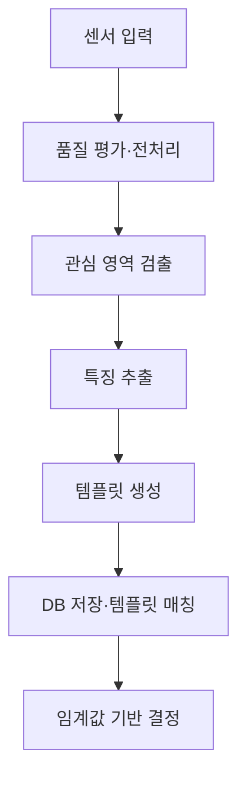

# 📝 [Week 14] 생체인식 시스템과 성능 평가 (Biometric Systems & Performance Evaluation)

## 1. 학습 개요

생체인식(Biometric Recognition)은 사람의 생리적 또는 행동적 특성을 센서로 측정하고, 이를 정량화한 특징을 이용해 개인의 신원을 확인하는 기술입니다.

기존의 인증 수단은 다음과 같은 한계를 가집니다.

- **열쇠·신분증·카드:** 분실, 복제, 도난 가능
- **비밀번호·PIN:** 망각, 유출, 재사용 가능
- **생체정보:** 사용자가 직접 지니고 있어 편리하지만 유출되면 비밀번호처럼 쉽게 변경하기 어려움

따라서 생체인식은 편의성과 보안성을 높일 수 있지만, 정확도뿐 아니라 개인정보 보호, 공정성, 위·변조 공격까지 함께 고려해야 합니다.

이번 주차에서는 다음 흐름으로 생체인식 시스템을 학습합니다.

> **생체정보 획득 → 등록 → 특징 템플릿 생성 → 인증·식별 → 임계값 결정 → FAR·FRR·EER·ROC 평가**

### 핵심 키워드

| 개념 | 의미 |
| --- | --- |
| **Enrollment** | 사용자의 생체 샘플로 등록 템플릿을 생성하는 과정 |
| **Verification** | 사용자가 주장한 신원이 맞는지 1:1로 확인 |
| **Identification** | 신원 주장 없이 DB 전체에서 사용자를 1:N으로 검색 |
| **FAR** | 타인을 정당한 사용자로 잘못 받아들이는 비율 |
| **FRR** | 정당한 사용자를 잘못 거부하는 비율 |
| **GAR** | 정당한 사용자를 올바르게 받아들이는 비율 |
| **EER** | FAR과 FRR이 같아지는 지점의 오류율 |
| **ROC** | 여러 임계값에서 FAR과 GAR의 관계를 나타내는 곡선 |

---

## 2. 생체정보의 종류

### 2.1 생리적 특성 (Physiological Characteristics)

신체 구조와 생리적 특징을 이용합니다.

- 얼굴, 얼굴 열상
- 지문, 장문, 손 모양
- 홍채, 망막
- 손등 정맥
- DNA

### 2.2 행동적 특성 (Behavioral Characteristics)

사람이 행동하는 방식에서 나타나는 개인차를 이용합니다.

- 음성
- 서명
- 걸음걸이
- 타이핑 리듬

행동적 특성은 사용자의 건강, 감정, 피로, 환경에 따라 달라질 수 있으므로 시간적 변화를 고려해야 합니다.

---

## 3. 좋은 생체정보의 7가지 조건

| 조건 | 의미 |
| --- | --- |
| **보편성(Universality)** | 대부분의 사람이 해당 특성을 가져야 함 |
| **유일성(Uniqueness)** | 사람마다 충분히 달라야 함 |
| **영구성(Permanence)** | 시간에 따라 크게 변하지 않아야 함 |
| **획득성(Collectability)** | 센서로 쉽고 안정적으로 측정할 수 있어야 함 |
| **성능(Performance)** | 정확도와 처리 속도가 충분해야 함 |
| **수용성(Acceptance)** | 사용자의 거부감이 낮아야 함 |
| **변조 곤란성(Circumvention Resistance)** | 복제·위조·우회가 어려워야 함 |

모든 조건을 완벽하게 만족하는 단일 생체정보는 없습니다.

- 얼굴: 획득성과 수용성이 높지만 조명·자세 변화와 사진·영상 위조에 취약할 수 있음
- 홍채: 유일성과 인식 성능이 높지만 센서 비용과 사용자 거부감이 문제가 될 수 있음
- 음성: 원격 수집이 편리하지만 소음과 녹음 재생 공격에 취약함

따라서 실제 시스템은 사용 목적과 환경에 맞춰 생체정보와 센서를 선택해야 합니다.

---

## 4. 생체인식 시스템의 구조



### 4.1 센서 입력

카메라, 지문 센서, 마이크, 적외선 센서 등을 이용해 생체 샘플을 획득합니다. 센서의 해상도, 조명, 거리, 노이즈는 이후 단계의 성능에 직접 영향을 줍니다.

### 4.2 품질 평가와 전처리

흐림, 가림, 노이즈, 과도한 회전처럼 비교에 부적합한 입력을 검사합니다. 필요에 따라 밝기 보정, 정규화, 노이즈 제거, 정렬을 수행합니다.

### 4.3 관심 영역 검출

전체 센서 영상에서 얼굴, 홍채, 지문 영역처럼 실제 특징을 추출할 위치를 찾습니다.

> 얼굴이 있는 **위치**를 찾는 검출(Detection), 얼굴을 수치 벡터로 바꾸는 임베딩(Embedding), 신원을 판단하는 인증·식별은 서로 다른 단계입니다.

### 4.4 특징 추출과 템플릿 생성

원본 입력에서 개인을 구별하는 특징을 추출해 고정된 형식의 템플릿으로 변환합니다. 원본 영상을 그대로 비교하는 것보다 필요한 특징 표현을 저장하는 경우가 많습니다.

### 4.5 매칭과 결정

입력 템플릿과 등록 템플릿을 비교해 유사도 또는 거리 점수를 계산합니다. 시스템은 임계값과 점수를 비교해 일치 여부를 결정합니다.

---

## 5. 등록·인증·식별

### 5.1 등록 (Enrollment)

등록은 사용자의 ID와 생체 샘플을 입력받아 특징 템플릿을 생성하고 데이터베이스에 저장하는 과정입니다.

등록 품질이 낮으면 이후 모든 비교의 기준이 불안정해집니다.

- 여러 번 측정한 샘플을 결합
- 일정한 품질 기준을 통과한 샘플만 등록
- 자세·조명·표정 등 다양한 조건의 샘플을 포함
- 템플릿을 안전하게 암호화·보호

### 5.2 인증 (Verification)

사용자가 “나는 A다”라고 신원을 주장하면 시스템은 입력 생체정보와 A의 등록 템플릿을 비교합니다.

```math
\text{Verification}=1:1\text{ Matching}
```

#### 대표 사용 사례

- 출입문 잠금 해제
- 스마트폰 잠금 해제
- 계좌·서비스 접근
- 특정 사용자의 본인 확인

### 5.3 인식·식별 (Identification)

사용자가 신원을 제시하지 않고 생체정보만 입력합니다. 시스템은 데이터베이스의 모든 템플릿과 비교해 가장 유사한 사람을 찾습니다.

```math
\text{Identification}=1:N\text{ Matching}
```

데이터베이스가 커질수록 다음 문제가 증가합니다.

- 비교 연산량
- 검색 지연 시간
- 유사한 오인식 후보의 수

### 5.4 인증과 식별 비교

| 구분 | 인증 | 인식·식별 |
| --- | --- | --- |
| 영어 | Verification, Authentication | Identification, Recognition |
| 신원정보 입력 | 있음 | 없음 |
| 비교 방식 | 1:1 | 1:N |
| 질문 | “입력 사용자가 주장한 A가 맞는가?” | “입력 사용자는 DB의 누구인가?” |
| 대표 사례 | 출입 통제, 기기 잠금 | 용의자 검색, 대규모 DB 탐색 |

---

## 6. 유사도 점수와 임계값

생체인식 시스템은 일반적으로 입력 템플릿과 등록 템플릿 사이의 유사도 점수 $s$를 계산하고 임계값 $\tau$와 비교합니다.

```math
s\geq\tau\Rightarrow\text{일치},
\qquad
s<\tau\Rightarrow\text{불일치}
```

이 관계는 점수가 클수록 비슷한 **유사도 점수**를 기준으로 합니다. Euclidean Distance처럼 값이 작을수록 비슷한 거리 점수를 사용하면 부등호 방향이 반대가 됩니다.

### 6.1 Genuine와 Impostor 분포

- **Genuine Matching:** 같은 사람의 템플릿끼리 비교한 점수 분포
- **Impostor Matching:** 서로 다른 사람의 템플릿을 비교한 점수 분포

이상적인 시스템에서는 두 분포가 완전히 분리되지만, 실제 환경에서는 조명·자세·센서 노이즈·개인 간 유사성 때문에 분포가 겹칩니다. 이 겹치는 영역에서 오승인과 오거부가 발생합니다.

---

## 7. 생체인식 성능 척도

### 7.1 FAR (False Acceptance Rate)

타인을 정당한 사용자로 잘못 받아들이는 비율입니다.

```math
FAR=
\frac{\text{잘못 승인된 Impostor 시도 수}}
{\text{전체 Impostor 시도 수}}
```

FAR이 높으면 공격자나 미등록 사용자가 시스템을 통과할 위험이 증가합니다.

### 7.2 FRR (False Rejection Rate)

정당한 사용자를 잘못 거부하는 비율입니다.

```math
FRR=
\frac{\text{잘못 거부된 Genuine 시도 수}}
{\text{전체 Genuine 시도 수}}
```

FRR이 높으면 정상 사용자가 반복적으로 인증에 실패해 사용성이 낮아집니다.

### 7.3 GAR (Genuine Acceptance Rate)

정당한 사용자를 올바르게 받아들이는 비율입니다.

```math
GAR=1-FRR
```

### 7.4 임계값과 FAR·FRR의 관계

유사도 임계값을 높이면 시스템의 판정이 엄격해집니다.

| 임계값 변화 | FAR | FRR | 시스템 성향 |
| :---: | :---: | :---: | --- |
| 증가 | 감소 | 증가 | 보안 강화, 사용 편의성 감소 |
| 감소 | 증가 | 감소 | 사용 편의성 증가, 보안 위험 증가 |

보안 시설은 침입 방지가 중요하므로 FAR을 매우 낮추는 운용점을 선호합니다. 소비자 기기는 일상적인 편의성까지 고려해 상대적으로 낮은 FRR을 선택할 수 있습니다.

### 7.5 EER (Equal Error Rate)

EER은 FAR과 FRR이 같아지는 지점의 오류율입니다.

```math
FAR(\tau^*)=FRR(\tau^*)=EER
```

일반적으로 EER이 낮을수록 Genuine과 Impostor 점수 분포의 분리가 좋습니다. 여러 알고리즘의 전체적인 분리 성능을 하나의 값으로 비교할 때 편리합니다.

다만 실제 서비스의 임계값이 반드시 EER 지점이어야 하는 것은 아닙니다. 보안 비용과 사용자 불편 비용이 서로 다르기 때문에 서비스 목적에 맞는 운용점을 선택해야 합니다.

### 7.6 ROC (Receiver Operating Characteristic)

ROC는 여러 임계값에서 FAR과 GAR의 관계를 나타냅니다.

- 가로축: FAR
- 세로축: GAR
- 왼쪽 위에 가까운 곡선: 낮은 FAR에서도 높은 GAR 유지

EER은 하나의 요약값이고 ROC는 가능한 모든 임계값의 동작을 보여줍니다. 따라서 특정 FAR 구간에서 어느 모델이 더 적합한지 분석하려면 ROC 곡선을 함께 확인해야 합니다.

### 7.7 지표 관계 정리

| 실제 시도 | 시스템 승인 | 시스템 거부 |
| --- | --- | --- |
| Genuine | 올바른 승인 → GAR | 잘못된 거부 → FRR |
| Impostor | 잘못된 승인 → FAR | 올바른 거부 |

> **중요:** 전체 정확도 하나만으로는 보안성과 사용성을 분리해 설명할 수 없습니다. FAR과 FRR을 함께 보고 실제 운용 임계값을 명시해야 합니다.

---

## 8. 주요 생체인식 기술 비교

| 기술 | 장점 | 한계 |
| --- | --- | --- |
| **지문** | 비교적 저렴하고 정확도가 높음 | 손상·건조·습기에 민감 |
| **홍채·망막** | 유일성과 인식 성능이 높음 | 센서 비용, 사용 편의성과 거부감 |
| **얼굴** | 비접촉·원거리 획득이 가능하고 편리함 | 조명·자세·가림·변장에 민감 |
| **음성** | 저렴한 마이크와 원격 사용 가능 | 소음, 감정·건강 변화, 녹음 재생 공격 |
| **정맥** | 외부에서 잘 보이지 않아 위조가 어려움 | 전용 센서와 비용 필요 |
| **손 모양** | 작동 방식이 단순함 | 구별력이 상대적으로 낮고 장치가 큼 |
| **서명** | 친숙하고 입력 장치가 저렴함 | 행동 변화와 모방에 취약 |

---

## 9. 다중 생체인식 (Multimodal Biometrics)

얼굴과 음성, 지문과 정맥처럼 여러 생체정보를 결합하면 한 생체정보의 약점을 다른 정보가 보완할 수 있습니다.

| 결합 수준 | 방식 |
| --- | --- |
| **센서 수준 결합** | 여러 센서의 원시 입력을 결합 |
| **특징 수준 결합** | 각 생체정보의 특징 벡터를 결합 |
| **점수 수준 결합** | 각 매처가 출력한 유사도 점수를 정규화해 결합 |
| **결정 수준 결합** | 각 시스템의 승인·거부 결정을 투표 등의 방식으로 결합 |

여러 생체정보를 결합한다고 항상 성능이 좋아지는 것은 아닙니다. 각 정보의 품질, 상관성, 가용성, 결합 가중치, 센서 비용을 함께 설계해야 합니다.

---

## 10. AI·딥러닝과의 연결점

### 10.1 특징 벡터와 메트릭 학습

현대 얼굴·지문 인식 모델은 입력을 고정 길이 임베딩 벡터로 변환합니다.

- 같은 사람의 임베딩은 가깝게 학습
- 다른 사람의 임베딩은 멀게 학습
- Cosine Similarity 또는 Euclidean Distance로 비교
- 임계값을 적용해 인증 여부 결정

이 과정은 분류 클래스만 예측하는 것이 아니라 **사람 사이의 거리 구조**를 학습하는 메트릭 학습과 연결됩니다.

### 10.2 색 기반 얼굴 검출 실습과의 연결

이전 주차의 YCbCr 피부색 마스킹과 바운딩 박스는 생체인식 파이프라인 중 **관심 영역 검출** 단계에 해당합니다.

```text
피부색 후보 추출
→ 가장 큰 연결 영역 선택
→ 얼굴 바운딩 박스
→ 얼굴 정렬
→ 임베딩 추출
→ 템플릿 매칭
→ 인증·식별
```

피부색만으로는 사람의 신원을 구분할 수 없으므로 정렬, 특징 추출, 템플릿 비교가 추가로 필요합니다.

### 10.3 공정성과 데이터 편향

피부색, 연령, 성별, 센서 환경에 따라 오류율이 다르면 전체 평균 정확도가 높아도 특정 집단에는 불공정할 수 있습니다.

- 전체 FAR·FRR뿐 아니라 집단별 지표 평가
- 학습 데이터의 인구통계적 구성 확인
- 센서와 환경 조건별 성능 분석
- 특정 집단에서 임계값이 다르게 작동하는지 점검

### 10.4 위·변조 탐지 (Presentation Attack Detection)

생체인식 모델이 정확해도 가짜 생체 샘플을 구분하지 못하면 보안 시스템으로 충분하지 않습니다.

#### 대표적인 공격

- 얼굴 사진 제시
- 화면을 이용한 영상 재생
- 딥페이크 영상
- 실리콘·젤라틴 지문
- 녹음된 음성 재생

이를 방어하기 위해 실제 생체 여부를 별도로 확인하는 Liveness Detection 또는 Presentation Attack Detection이 필요합니다.

---

## 11. 개인정보 보호와 시스템 설계

생체정보는 비밀번호처럼 쉽게 변경할 수 없으므로 원본과 템플릿을 안전하게 보호해야 합니다.

- 원본 생체영상의 불필요한 저장 최소화
- 템플릿 암호화와 접근 통제
- 템플릿 유출 시 재발급 가능한 보호 기법 고려
- 수집 목적과 보관 기간 명시
- 사용자 동의 및 삭제 절차 제공
- 전송 구간 암호화

높은 인식 정확도만으로 안전한 생체인식 시스템이 완성되지는 않습니다. 센서, 등록, 템플릿 보호, 임계값, 공격 탐지, 개인정보 정책을 하나의 시스템으로 설계해야 합니다.

---

## 12. 핵심 정리

- 생체인식은 생리적·행동적 특성을 정량화해 개인의 신원을 확인합니다.
- 좋은 생체정보는 보편성, 유일성, 영구성, 획득성, 성능, 수용성, 변조 곤란성을 고려해야 합니다.
- 등록 품질은 이후 모든 인증·식별 성능의 기준이 됩니다.
- 인증은 1:1 비교, 식별은 1:N 검색입니다.
- 임계값을 높이면 FAR은 감소하지만 FRR은 증가합니다.
- EER은 모델 비교에 유용하지만 실제 서비스의 최적 임계값과 같을 필요는 없습니다.
- ROC는 여러 임계값에서 보안성과 사용성의 교환 관계를 보여줍니다.
- 정확도뿐 아니라 공정성, 템플릿 보호, 위·변조 탐지를 함께 평가해야 합니다.

> **핵심 문장:** 생체인식 성능은 단일 정확도로 설명할 수 없습니다. 1:1과 1:N 문제를 구분하고, 목적에 맞는 임계값에서 FAR과 FRR의 교환 관계를 평가해야 합니다.
